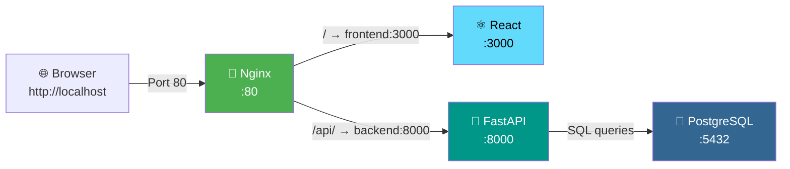

# Project 16 — Troubleshooting 502 Bad Gateway: Complete Implementation

## Project Structure (19 files)

```
AWS-PROJECT/
├── 📁 frontend/                        # React SPA
│   ├── Dockerfile                      # Multi-stage: build → serve
│   ├── package.json                    # Dependencies (React 18)
│   ├── public/index.html               # HTML template
│   └── src/
│       ├── index.js                    # React entry point
│       ├── index.css                   # Global styles
│       ├── App.js                      # Main component (health, form, table)
│       └── App.css                     # Component styles
│
├── 📁 backend/                         # FastAPI REST API
│   ├── Dockerfile                      # Python 3.11 slim
│   ├── requirements.txt                # FastAPI, SQLAlchemy, psycopg2
│   └── app/
│       ├── __init__.py
│       ├── main.py                     # Routes: /api/health, /api/students
│       ├── database.py                 # SQLAlchemy engine + session
│       ├── models.py                   # Student ORM model
│       └── schemas.py                  # Pydantic request/response schemas
│
├── 📁 nginx/                           # Reverse proxy
│   ├── Dockerfile                      # Nginx 1.25 Alpine
│   ├── nginx.conf                      # ✅ Correct config
│   ├── nginx-broken.conf              # ❌ Broken config (for demo)
│   └── 502.html                        # Custom 502 error page
│
├── docker-compose.yml                  # Orchestration (4 services)
├── .env.example                        # Template environment variables
├── .env                                # Actual env vars (gitignored)
├── .gitignore                          # Git exclusion rules
└── README.md                           # Full documentation
```

## Architecture



## Troubleshooting Demo: What Goes Wrong

The broken config (`nginx-broken.conf`) introduces **two deliberate errors**:

| Setting | Correct (nginx.conf) | Broken (nginx-broken.conf) | Error Type |
|---------|---------------------|---------------------------|------------|
| Frontend upstream | `frontend:3000` | `frontend:9999` | Wrong port → Connection refused |
| Backend upstream | `backend:8000` | `backend:9999` | Wrong port → Connection refused |

### Diagnosis commands
```bash
docker ps                       # All containers running? ✅ Yes
docker logs nginx-proxy         # Error logs → "host not found", "connection refused"
docker exec nginx-proxy cat /etc/nginx/conf.d/default.conf   # See wrong names/ports
docker network inspect aws-project_app-network               # Valid service names
```

### Fix
```bash
docker cp nginx/nginx.conf nginx-proxy:/etc/nginx/conf.d/default.conf
docker exec nginx-proxy nginx -s reload
```

## Quick Start Commands

```bash
# 1. Setup
cp .env.example .env

# 2. Build & Start
docker compose up --build -d

# 3. Verify
docker ps
curl http://localhost/api/health

# 4. Break it (502 demo)
docker cp nginx/nginx-broken.conf nginx-proxy:/etc/nginx/conf.d/default.conf
docker exec nginx-proxy nginx -s reload
curl http://localhost          # → 502

# 5. Fix it
docker cp nginx/nginx.conf nginx-proxy:/etc/nginx/conf.d/default.conf
docker exec nginx-proxy nginx -s reload
curl http://localhost/api/health   # → healthy ✅

# 6. Cleanup
docker compose down -v
```

## API Endpoints

| Method | Endpoint | Description |
|--------|----------|-------------|
| GET | `/api/health` | System health + DB connection check |
| GET | `/api/students` | List all students (newest first) |
| POST | `/api/students` | Create a student `{name, email, course}` |
| GET | `/api/students/{id}` | Get student by ID |
| DELETE | `/api/students/{id}` | Delete student by ID |
| GET | `/api/docs` | Swagger UI documentation |

## Key Design Decisions

| Decision | Rationale |
|----------|-----------|
| Only Nginx exposes port 80 | Security: backend and DB are internal-only |
| Environment variables for DB creds | No hardcoded secrets in source code |
| Docker volume for PostgreSQL | Data persists across container restarts |
| Multi-stage frontend build | Smaller final image (no node_modules) |
| Health checks on all services | Docker can monitor and restart unhealthy containers |
| Custom 502 error page | Provides troubleshooting hints right in the browser |
| `nginx -s reload` (not restart) | Demonstrates zero-downtime config reload |
